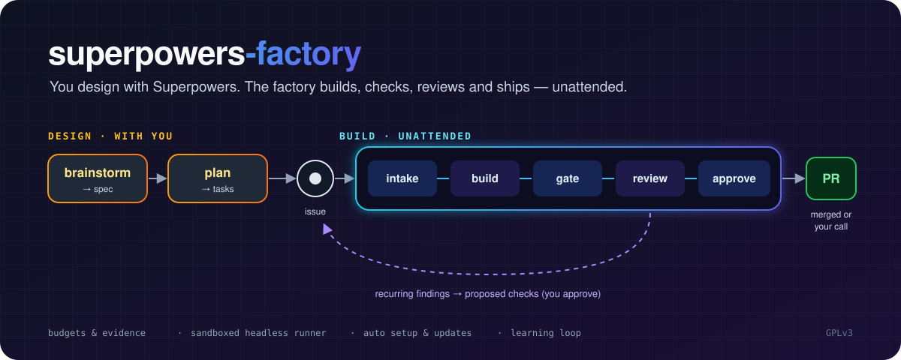

# superpowers-factory



**You design the feature with Claude. The factory builds it.**

superpowers-factory is a Claude Code plugin that joins two halves of the work:

- **Design, with you.** You brainstorm and write a plan interactively using the
  [Superpowers](#requirements) skills.
- **Build, unattended.** The plan becomes one GitHub issue. A software factory of
  Claude agents picks it up, writes the code on its own branch, runs your
  project's checks, reviews the change, and either merges the pull request or
  hands it to you with the evidence.

You stay in charge of the decisions: what gets built, what's allowed to merge,
and how much it may spend.

This is automation with **harness engineering**: the effort goes into the
system around the model (checks, state, permissions, budgets, review and
evidence), so that unattended work is work you can trust.
[Why that matters](#why-a-factory-harness-engineering).

---

## Contents

- [Why a factory: harness engineering](#why-a-factory-harness-engineering)
- [How it works](#how-it-works)
- [Requirements](#requirements)
- [Install](#install)
- [Quick start](#quick-start)
- [Everyday use](#everyday-use)
- [Configuration](#configuration)
- [Hands-off running](#hands-off-running)
- [Using another agent](#using-another-agent)
- [The learning loop](#the-learning-loop)
- [Safety: what stays with you](#safety-what-stays-with-you)
- [What the plugin runs, writes and sends](#what-the-plugin-runs-writes-and-sends)
- [Troubleshooting](#troubleshooting)
- [Support and security](#support-and-security)
- [Contributing and license](#contributing-and-license)

---

## Why a factory: harness engineering

Getting an agent to write code is the easy part. The hard part is knowing
whether to trust what it wrote. Plain automation ("here's the issue, open a
PR") speeds up the typing and leaves all of the checking with you, and it gets
less reliable the longer it runs on its own.

A harness is everything around the model: the code that decides what the model
may do, checks what it did, and records what happened. In this factory the
model proposes and the harness decides.

| Plain automation | What the harness does here |
|---|---|
| The agent says "done, tests pass." | `factory/bin/gate` runs your `factory/checks.sh`. An exit code decides pass or fail. |
| The agent edits the test or the check until it goes green. | `protected_paths`: no job can change the checks or the config it is judged by. |
| The author reviews its own work. | Separate reviewer agents, each starting from a clean context, then an approver. UI and security reviewers join when the change touches those areas. |
| A stuck agent loops and spends. | `max_rounds`, per-job and daily budgets, enforced in code. |
| State lives in a chat that can be lost. | One state machine (`factory/bin/job`) is the only writer of job state. Each job has its own git worktree, and every agent run keeps its prompt, log and cost. |
| The agent guesses what you meant. | You design the feature first. The committed spec and plan are what the builder carries out. |
| One model setting for everything. | Model and effort are chosen per role and per risk level, from config. |
| The same mistake comes back every week. | The [learning loop](#the-learning-loop) turns recurring review findings into a lint rule, a test or a check. |
| You take the agent's word for it. | Every PR carries an evidence block: check output, acceptance criteria, each reviewer's verdict, cost and time. |
| A bad merge sits on the base branch. | The factory watches the merged commit's CI, pauses the queue and opens a revert PR. |

What this changes for you:

- **You review decisions and evidence**, not every line an agent typed.
- **Quality compounds.** A failure that keeps happening becomes a check, so it
  stops depending on a prompt being followed.
- **Unattended runs stay bounded.** What a job may touch, spend and merge is
  set by code and config you own.
- **Cheaper models go further.** The harness catches what a smaller model
  misses, so most builds run on the `balanced` tier by default.

The bundled `agents-best-practices` skill holds the harness-engineering
guidance the factory follows, and you can use it to design or audit your own
agents.

---

## How it works

```
 you + Claude                         the factory (unattended)
┌─────────────┐   ┌──────┐   ┌───────┐   ┌────────┐   ┌───────┐   ┌──────┐   ┌────────┐   ┌─────────┐   ┌────┐
│ brainstorm  │ → │ plan │ → │ issue │ → │ intake │ → │ build │ → │ gate │ → │ review │ → │ approve │ → │ PR │
└─────────────┘   └──────┘   └───────┘   └────────┘   └───────┘   └──────┘   └────────┘   └─────────┘   └────┘
                                 ▲                                                │
                                 └─────── recurring findings → proposed checks ───┘
```

1. **Design.** In a normal Claude Code session you use Superpowers'
   brainstorming and writing-plans skills. The result is a spec and a step-by-step
   plan, committed to your repo.
2. **Hand off.** When writing-plans asks how to run the plan, pick
   **"3. Factory"**. `/factory-handoff` files one GitHub issue labeled
   `factory` + `factory:planned` that points at the committed spec and plan.
3. **Build.** `/factory run` (or the scheduled runner) takes each labeled issue
   through these stages, one job per issue:

   | Stage | Who | What happens |
   |---|---|---|
   | intake | `intake` agent | Decides whether the issue is worth building and how risky it is. Planned issues skip this; their plan is used as written. |
   | spec | `spec-writer` agent | Turns the issue into testable acceptance criteria (skipped for planned issues). |
   | build | `builder` agent | Implements the work in its own git worktree, test-first, and opens a draft PR. |
   | gate | `factory/bin/gate` | Runs your `factory/checks.sh` (tests, lint, build). Code, not a model, decides pass or fail. |
   | review | reviewer agents | A code reviewer always; UX, UI and security reviewers when the change touches those areas. |
   | approve | `approver` agent | Merges what it would merge itself, or escalates the PR to you. |

   A failed gate or a review asking for changes sends the job back to build,
   up to `max_rounds` times.
4. **Finish.** Every PR the factory sends to the approver or to you carries an
   **evidence block**: files changed, check output, acceptance criteria, each
   reviewer's verdict, and the cost and time spent. Jobs that need you are
   labeled `factory:needs-human`.

Plain issues work too: label any issue `factory` and the factory takes it from
intake. The plan-based route is better for anything larger than a small fix.

---

## Requirements

- **Claude Code** 2.1.257 or later. The plugin needs a terminal, git and a
  local checkout, so it does nothing useful in Claude chat or Cowork.
- **The Superpowers plugin**, installed in Claude Code. The factory's builder
  uses its test-driven-development, debugging and verification skills.
- **GitHub**: a project with an `origin` on GitHub, and the
  [`gh` CLI](https://cli.github.com) logged in with an account that can push
  and manage labels.
- **Python 3.10+** (the factory's scripts use only the standard library).
- macOS or Linux, only if you want the [scheduled runner](#hands-off-running).

---

## Install

In Claude Code:

```text
/plugin marketplace add nandan-exale/superpowers-factory
/plugin install superpowers-factory@superpowers-factory
```

Restart Claude Code (or open a new session) so the plugin's skills and hooks
load.

To update later:

```text
/plugin marketplace update superpowers-factory
/plugin update superpowers-factory@superpowers-factory
```

If you installed it for a single project (`--scope project`), run the update
from that project with the same scope.

### Other agents

The `plugins` CLI (Node.js 18+) installs the plugin into every supported agent
it finds on your `PATH`: Claude Code, Codex, Cursor and GitHub Copilot CLI.

```bash
npx plugins add nandan-exale/superpowers-factory
```

Add `-t <target>` to install into one agent only (`claude-code`, `codex`,
`cursor`, `github-copilot`), and set `DISABLE_TELEMETRY=1` to turn off its
install telemetry. To update, run the same command again. Install from GitHub
as shown, not from a local checkout: a local path is copied whole, `.git` and
`.worktrees/` included.

The factory itself still runs on Claude Code; other agents get the install,
handoff and update skills. Codex runs the plugin's session hook only after you
trust it with `/hooks`. Each agent also needs
[Superpowers](#requirements) installed.

Installed it before the marketplace was renamed (as
`superpowers-factory@superpowers-factory-dev`)? Remove the old marketplace and
install again:

```text
/plugin marketplace remove superpowers-factory-dev
/plugin marketplace add nandan-exale/superpowers-factory
/plugin install superpowers-factory@superpowers-factory
```

---

## Quick start

1. **Open a session in your project.** The plugin notices the factory isn't
   installed and offers `/factory-install`. Say yes.
2. **Let it set up.** It copies the factory into the project and adapts it:
   - writes your real test, lint and build commands into `factory/checks.sh`;
   - tailors the reviewer checklists to your stack;
   - creates the GitHub labels;
   - adds a CI workflow and a check that runs before a session ends;
   - runs `factory/bin/doctor` to confirm everything is in place.

   Review the changes, then commit and push them yourself.
3. **Start a fresh session.** The factory's agents load at session start.
4. **Design something.** Ask Claude to build a feature. Superpowers takes you
   through brainstorming and a written plan.
5. **Hand it off.** When asked how to execute the plan, choose
   **"3. Factory"**. Confirm the risk level, and the issue is filed.
6. **Run the factory.** In a fresh session: `/factory run`, or
   `factory/bin/orchestrate run` from a terminal. Watch the PR appear on GitHub. Start with `concurrency: 1` and read every PR until you
   trust it.

### Things to ask

- "Set up the software factory in this project." Runs `/factory-install`.
- "Let's add CSV export to the reports page." Superpowers brainstorms and
  writes the plan; then choose **"3. Factory"** to file it as an issue.
- "Hand this plan to the factory." Runs `/factory-handoff` on the plan you
  just approved.
- `/factory run`. Builds every open issue labeled `factory`.
- `/factory what needs me?` Lists the jobs waiting on your decision.

---

## Everyday use

### Commands

| Command | Where | What it does |
|---|---|---|
| `/factory-install` | Claude Code, in a project | Sets the factory up in the current project. |
| `/factory-update` | Claude Code, in a project | Updates an installed factory to the plugin's version. Keeps your changes, shows every diff, never commits. |
| `/factory-uninstall` | Claude Code, in a project | Removes the factory from this project (keeps job history and labels). |
| `/factory-handoff` | Claude Code, after a plan | Files the committed spec and plan as one `factory:planned` issue. |
| `/factory run` | Claude Code | Builds every open `factory` issue, `concurrency` at a time. |
| `/factory run <n>` | Claude Code | Builds only issue `#n`. |
| `factory/bin/orchestrate run [<n>]` | terminal | The same as `/factory run [<n>]`, without a Claude Code session. |
| `/factory <anything>` | Claude Code | Ask about jobs, give feedback on an escalated PR, or describe a new feature. |
| `factory/bin/doctor` | terminal | Checks the install. `--fast` skips running your checks. |
| `factory/bin/job summary` | terminal | Table of jobs: stage, PR, cost against budget, time. |
| `factory/bin/job queue` | terminal | What `/factory run` would do with each issue right now. |

Each agent runs as its own `claude -p` process, started by
`factory/bin/orchestrate`; `factory/jobs/<id>/runs/` holds every run's prompt,
log and cost.

A live dashboard: `cd factory && python3 -m http.server`, then open
<http://localhost:8000/dashboard.html>.

**Large plans.** When a plan has more tasks than
`handoff.max_tasks_per_part` (8 by default), `/factory-handoff` proposes
splitting it into parts and files one issue per part, in order. Each part is
its own PR, carrying out only its task range. A part waits
(`wait … depends #N` in `job queue`) until the part before it has merged; if
that part is rejected or its issue is closed unmerged, the next part stops at
`needs-human` so you can re-plan.

### Approving and steering

- **To approve** an escalated PR, merge it on GitHub.
- **To change it**, comment on the PR. Comments from you (and logins in
  `pr_feedback.allowed`) reach the builder automatically on the next run. You
  can also use `/factory <what to change>`.
- **To stop** a job, close the issue or reject it with `/factory`.

### What needs me?

The factory comments as you, and GitHub doesn't notify you about your own
comments. So set up a notification, or check two places instead:

- **A notify command.** Set `notify.command` in `factory/config.json` and the
  factory runs it whenever a job moves to needs-human or needs-info. It runs
  without a shell; the details arrive as `FACTORY_NOTIFY_TITLE`,
  `FACTORY_NOTIFY_MESSAGE`, `FACTORY_NOTIFY_URL`, `FACTORY_NOTIFY_STAGE` and
  `FACTORY_NOTIFY_JOB`. A macOS desktop notification:

  ```json
  "notify": {"command": ["osascript", "-e", "display notification (system attribute \"FACTORY_NOTIFY_MESSAGE\") with title (system attribute \"FACTORY_NOTIFY_TITLE\")"]}
  ```

  For your phone, point it at a small script of your own that forwards the
  same variables to a push service such as ntfy.sh.
  The command runs where the factory runs, so a desktop notification works for
  `/factory run` and the macOS runner, not on GitHub Actions. If it fails, the
  factory prints a `NOTE:` and carries on.

- **The digest issue.** Once a day after `digest.hour` (local time), the
  factory posts a report on the pinned issue labeled `factory:digest`. Its
  first line lists what needs you, for example
  `Needs you: #12 (needs-human, 2d), #15 (needs-info, 5h)`. A runner posts it
  on its own; without one, the end of each `/factory run` posts it.
- **A saved search.** On your repo's Issues tab, search
  `is:open label:factory:needs-human,factory:needs-info` and save it.

`/factory report` prints the same report (spend, throughput, escalations,
findings, gate pass rate) without posting it, and the dashboard shows a summary
strip from `factory/jobs/report.json`.

### Keeping the factory up to date

When the plugin is newer than a project's factory, Claude offers
`/factory-update` at the start of a session. It copies files you haven't
changed, adds new config keys while keeping your values, never touches
`factory/checks.sh`, and asks you about any file both you and the plugin
changed.

### Removing the factory

Run `/factory-uninstall` in the project. It stops the runner, removes the
factory's files, Stop hook, CI workflow and AGENTS.md section, and shows you
the diff to commit. It keeps `factory/jobs/` (your job history), your own
`factory/checks.sh` and the GitHub labels, and prints the commands to delete
them if you want to. It refuses while a job still has a worktree.

---

## Configuration

Everything lives in **`factory/config.json`** in your project. The factory can't
change this file itself; edit it by hand and commit.

### The basics

| Key | Default | Meaning |
|---|---|---|
| `concurrency` | `3` | How many jobs run at once. Start with `1`. |
| `max_rounds` | `3` | Build → review rounds before a job is escalated to you. |
| `base_branch` | `"main"` | Branch jobs start from and merge into. |
| `merge_method` | `"merge"` | `merge`, `squash` or `rebase` (must be allowed by the repo). |
| `protected_paths` | `factory/checks.sh`, `factory/config.json` | Files no job may change. Add paths only when no job should ever touch them. |
| `ports` | `{"base": 5100, "step": 10}` | Ports given to each job's dev server. |
| `labels` | `factory`, `factory:planned`, … | GitHub label names, if you need different ones. |
| `digest` | `{"enabled": true, "hour": 9, "days": 1}` | `enabled`, `hour` (local, 0–23) and `days` (the period the digest covers). Set `enabled` to `false` to stop posting. |
| `notify` | none | `{"command": [...]}`: a program and its arguments, run whenever a job moves to needs-human or needs-info. See "What needs me?". |

### Models and effort

No agent file names a model; every agent's model and effort come from config,
chosen per job by its risk:

```json
"agents":  { "intake":  { "tier": "strong", "effort": "high" },
             "learner": { "tier": "strong", "effort": "high" } },
"routing": {
  "low":    { "spec-writer": {...}, "builder": {...}, "approver": {...}, "code": {...} },
  "medium": { ... },
  "high":   { ... }
},
"surface_reviewers": {
  "ui":       { "ux": {...}, "ui": {...} },
  "security": { "security": {...} }
}
```

- `tier` is one of `fast`, `balanced`, `strong`, `frontier`; `runtimes.<runtime>.tiers`
  maps each to a model (for Claude: haiku, sonnet, opus, fable).
- `effort` is one of `low` … `max`.
- By default builders use `balanced` (Sonnet) for low- and medium-risk jobs and
  `strong` (Opus) for high-risk ones. Builders use most of the factory's tokens, so
  this keeps usage limits further away; raise `routing.<risk>.builder.tier` if you
  want Opus everywhere.
- `routing.<risk>.code` is the code reviewer; `surface_reviewers` adds reviewers
  when intake says a change touches the UI or security.
- See what an agent will run on: `factory/bin/job agent <job> <role>`.

### Budgets

```json
"budgets": { "job_usd": 25, "job_hours": 6, "daily_usd": 100 }
```

| Key | Meaning |
|---|---|
| `job_usd` | Most a single job may spend (API-equivalent). Over it, the job stops and comes to you. |
| `job_hours` | Longest a job may take from the start of its build. |
| `daily_usd` | Most the factory may spend in any 24 hours. Past it, nothing new starts until spend drops. |

Set any of them to `null` to turn that limit off. Your feedback on an escalated
job gives it a fresh allowance. Costs are API-equivalent estimates from the
agents' token usage (`prices_usd_per_mtok`).

### PR comments

```json
"pr_feedback": { "allowed": ["teammate-login"] }
```

Who, besides you (the `gh` account running the factory), may steer a job by
commenting on its PR. Bots and everyone else are ignored.

### Learning loop

```json
"learning": { "threshold": 3, "window_days": 30, "tags": ["missing-test", "error-handling", "..."] }
```

How many different jobs must raise the same kind of finding, within how many
days, before the factory proposes a fix. `tags` is the list reviewers choose
from.

### Scheduled runner

```json
"runner": { "interval_minutes": 15, "max_minutes": 120, "keychain_service": "factory-claude-token" }
```

How often the runner checks for work, how long one run may take, and the
Keychain item holding its token. See below.

### Other files you own

| File | What it is |
|---|---|
| `factory/checks.sh` | Your project's checks. Must exit non-zero on any failure. |
| `factory/runner-settings.json` | Sandbox and permission rules for every agent the factory starts. Add your package registries to `sandbox.network.allowedDomains`. |
| `factory/agents/reviewer-*.md` | Reviewer checklists, tailored at install. |
| `AGENTS.md` | Setup and validation commands every agent reads. |

---

## Hands-off running

Want the factory to work while you're away? The runner starts
`factory/bin/orchestrate run` on a schedule, but only when there's work.

1. **Make a separate clone** of your project for the runner. It never touches a
   checkout with uncommitted changes.
2. **Give it a login token** (you do this; the plugin never sees it):
   ```bash
   claude setup-token
   security add-generic-password -s factory-claude-token -a "$USER" -w
   ```
   Paste the token when `security` asks.
3. **Turn on branch protection** for your base branch on GitHub (no force
   pushes, no deletion).
4. **Install the schedule**, in the runner's clone:
   ```bash
   factory/bin/runner install
   ```

Check on it with `factory/bin/runner status`. Remove it with
`factory/bin/runner uninstall`.

Each run is headless, uses `--permission-mode dontAsk`, and runs commands in
Claude Code's sandbox: writes stay in the project, network access is limited
to GitHub and the hosts you list, and anything not allowed is refused rather
than asked about.

### Linux (systemd)

```bash
sudo apt install bubblewrap socat          # Claude Code's Linux sandbox
claude setup-token                         # prints a long-lived token
secret-tool store --label factory service factory-claude-token   # paste it
# or: mkdir -p ~/.config/factory && install -m 600 /dev/stdin ~/.config/factory/claude-token
factory/bin/runner install                 # a systemd user timer every runner.interval_minutes
loginctl enable-linger "$USER"             # keep it running while you're logged out
factory/bin/doctor
```

`factory/bin/runner status` shows the timer and the log; `factory/bin/runner
uninstall` removes it. The runner refuses a token file that isn't mode 600
and yours, and won't start Claude without bubblewrap and socat.

### GitHub Actions

`/factory-install` can add `.github/workflows/factory-runner.yml` (off by
default). It runs `factory/bin/runner tick --ci` on a schedule, with your
`FACTORY_CLAUDE_TOKEN` and `FACTORY_GH_TOKEN` secrets. Runners are fresh
machines, so job state lives on an orphan `factory-state` branch that only
the runner writes, and missing worktrees are recreated from their pushed
branches. Work a run didn't push is redone by the next one. If saving state
fails twice, the run goes red and keeps `factory/jobs` as a workflow
artifact. Check the setup with `factory/bin/doctor --ci`.

---

## Using another agent

The factory's agents can run under Claude Code, OpenAI Codex CLI, OpenCode,
GitHub Copilot CLI or Cursor CLI: one per project, set by `runtime` in
`factory/config.json` (`claude`, `codex`, `opencode`, `copilot`, `cursor`).

- **Install the plugin** in any of these agents with
  `npx plugins add nandan-exale/superpowers-factory` (see
  [Other agents](#other-agents)). The skills need the plugin's other files,
  so installing the skill folders alone (`npx skills add`) isn't enough.
- **`/factory-install` asks for the runtime** and, for anything but Claude,
  the model id for each tier routing uses (`fast`, `balanced`, `strong`,
  `frontier`), written to `runtimes.<runtime>.tiers`. Routing names tiers, so
  nothing else changes. The factory section goes in `AGENTS.md`, which every
  one of these agents reads.
- **Run it** with `/factory run` in your agent, or `factory/bin/orchestrate
  run` in a terminal.

What differs per runtime:

| | Cost | Resume | Notes |
|---|---|---|---|
| `claude` | reported by the CLI | yes | Stop hook runs `checks.sh` in interactive sessions |
| `opencode` | reported by the CLI | yes, but it can't tell a lost session from a new one, so a lost one starts over | |
| `codex` | tokens × `runtimes.codex.prices_usd_per_mtok`; `n/a` until you set prices | yes | |
| `cursor` | tokens × `runtimes.cursor.prices_usd_per_mtok`; `n/a` until you set prices | yes | not on GitHub Actions (its CLI has no pinned npm package) |
| `copilot` | `n/a` | yes | uses your `gh` login; no stored credential |

- **Unknown cost.** Where cost is `n/a (<k> runs)`, the dollar budgets can't
  see the spend: set `budgets.job_runs` (agent runs per job) and
  `budgets.daily_runs` (per 24 hours). `factory/bin/doctor` warns until you do.
- **Checks before the gate.** Only Claude Code runs the Stop hook. On other
  runtimes the builder gets one nudge to fix failing checks before the gate,
  and the gate runs `checks.sh` on every runtime.
- **Deny rules bind only Claude Code.** `factory/runner-settings.json`'s rules
  (secret files, force pushes) are Claude Code settings. Other agents aren't
  held to them; the factory checks after each read-only agent that it changed
  nothing but its own file, and the runner hands each agent only its own
  runtime's credential. `doctor` says so.
- **Runner credentials.** The runner reads the credential from the Keychain
  item `factory-<runtime>-token` (Claude keeps `runner.keychain_service`), or
  on Linux from `secret-tool` (service `factory-<runtime>-token`) or
  `~/.config/factory/<runtime>-token` (mode 600). On GitHub Actions the secret
  is `FACTORY_<RUNTIME>_TOKEN` (for example `FACTORY_CODEX_TOKEN`), and
  `factory/bin/runner workflow --cli-version X.Y.Z` pins that runtime's CLI.
  Only Claude Code needs bubblewrap and socat.

---

## The learning loop

Reviewers tag every finding (`[missing-test]`, `[error-handling]`, …). When the
same tag keeps coming up across jobs, the factory's `learner` drafts the
smallest automatic fix — a lint rule, a test, a check script, or an
`AGENTS.md` rule — and files it as a **`factory:learning`** issue with the
evidence.

Nothing changes until you decide: read the proposal, and **add the `factory`
label** if you want the factory to build it. Proposals that need a protected
file say so, and are yours to make.

---

## Safety: what stays with you

- **Merging.** Only the approver or you merge, and only after the checks pass
  and the reviewers agree. Merging an escalated PR on GitHub is your approval.
- **Spending.** Per-job and daily budgets are enforced in code, not left to the
  model.
- **Your checks.** Jobs can't change `factory/checks.sh` or
  `factory/config.json`, so a job can't weaken the checks it's judged by.
- **New rules.** Learning proposals only become work when you add the label.
- **Credentials.** The runner's token stays in your Keychain and is kept away
  from the commands agents run.

### After the merge

- **Watching the base branch.** After each merge the factory watches the
  workflow runs on the merged commit (`watch` in `factory/config.json`). If
  one fails, it pauses the queue, opens a `Revert "<title>"` PR labeled
  `factory:revert`, and comments on the original PR and issue. It never merges
  the revert. Merge it or fix forward, then run `factory/bin/job resume`.
- **Pausing by hand.** `factory/bin/job pause <reason>` stops new work and
  merges; `factory/bin/job resume` clears it. `doctor`, `job summary` and the
  dashboard show the pause.
- **Risky changes.** A PR that changes files matching `risky_paths`
  (dependencies, lock files, CI workflows, Dockerfiles, Terraform) is reviewed
  as usual but stops before merging. Review it, add `factory:risk-ok` to the
  issue and run `/factory run` again, or merge it yourself. The label covers
  the commit you reviewed: if the branch changes again, it stops again.
- **Secrets.** The builder pushes with `factory/bin/job push`, which refuses
  to push added lines that look like private keys or tokens. Merge commits are
  scanned against their first parent. Private keys and AWS, GitHub, Anthropic
  and Slack tokens are flagged on every path; `secret_scan.allow` (default
  `**/*.test.*`, `**/fixtures/**`) exempts paths only from the "assigned
  secret" heuristic. The gate scans again; a hit there stops the job and asks
  you to rotate the secret. This is a backstop, not a replacement for GitHub
  secret scanning.

Good to know:

- Your project's tests run with full network and disk access when the gate
  runs them (they never see the token).
- The factory can comment, open PRs and push branches on GitHub as your `gh`
  account.
- Changes to the factory's own files take effect once merged into the base
  branch, so review them like any other change.

---

## What the plugin runs, writes and sends

Everything below happens on your machine or in your GitHub project. The plugin
has no server of its own, and no telemetry.

**At session start.** A hook runs `hooks/factory-session.py`. It runs
`git` to read the project's `origin` and checks whether `factory/` exists, then
tells Claude one of three things: offer `/factory-install`, offer
`/factory-update`, or offer the factory as a third way to execute a Superpowers
plan. It writes nothing and makes no network calls. If you decline the install
offer, `tools/factory-state decline` writes a `factory-declined` marker in the
clone's `.git` folder; `tools/factory-state reset` removes it.

**When you run `/factory-install`.** After you say yes, it writes into the
project, and leaves the commit to you:

- `factory/`, `factory/agents/` and `.claude/skills/factory/`: the factory;
- a Stop hook in `.claude/settings.json` that runs `factory/checks.sh` before
  an interactive session ends;
- `.github/workflows/factory-checks.yml`, and `factory-runner.yml` only if you
  choose the GitHub Actions runner;
- a section in `AGENTS.md` (and an `@AGENTS.md` line in `CLAUDE.md`), and
  entries in `.gitignore`;
- GitHub labels, created with your `gh` login.

`/factory-uninstall` removes these, except the labels, the `.gitignore`
entries and your job history.

**When the factory runs a job.** `factory/bin/orchestrate` starts your agent
CLI headless, once per agent. With Claude Code that is `claude -p
--permission-mode dontAsk`: nothing is asked, so anything outside the allow
list in `factory/runner-settings.json` is refused. Commands run in Claude
Code's sandbox, with the network limited to GitHub and the hosts you add.
Agents edit files in the job's worktree, run `git` and `gh`, push the job's
branch, open a pull request and comment on it, and the approver merges it when
the checks pass and the reviewers agree. The same file denies reading `.env`
and `~/.ssh`, force pushes, and edits to the factory's own scripts, config and
checks. Other runtimes are looser: Copilot CLI runs with `--allow-all-tools`
and Cursor CLI with `--force`, and
[the deny rules bind only Claude Code](#using-another-agent).

**When you install the scheduled runner.** `factory/bin/runner install` adds a
LaunchAgent (macOS) or a systemd user unit (Linux) that starts the orchestrator
on a schedule. It reads a login token that you stored yourself in the Keychain,
`secret-tool` or `~/.config/factory/`; the plugin never asks for it and agents
can't read it. `factory/bin/runner uninstall` removes the schedule.

**What leaves your machine.**

- To GitHub, through your own `git` and `gh`: branches, pull requests, issues,
  comments and labels in your project.
- To your model provider, through the agent CLI you already use: the same
  prompts and code any session with that agent sends.

Nothing is sent to the plugin's author. Job state, costs and review findings
stay in `factory/jobs/` in your clone (gitignored); the learning loop reads
only those files. The plugin stores no personal data and is not aimed at
children.

---

## Troubleshooting

| Problem | Try |
|---|---|
| Something seems off | `factory/bin/doctor` lists each check as PASS, WARN or FAIL with the fix. |
| `factory/bin/orchestrate` can't find an agent | `factory/bin/doctor` names the missing file in `factory/agents/`; `/factory-update` restores it. |
| Claude doesn't offer `/factory-install` | The project needs a GitHub `origin`. If you declined before, `tools/factory-state reset` (in the plugin) brings the offer back. |
| A job is stuck or escalated | `factory/bin/job summary`, then read the PR's evidence block and the latest `factory/jobs/<job>/decision.md`. |
| The runner isn't running | `factory/bin/runner status` shows the last runs and why it skipped. |
| Nothing starts, `wait … daily budget` | The daily spend limit is reached; it clears as the last 24 hours roll over, or raise `budgets.daily_usd`. |

---

## Support and security

- **Questions and bugs:** open an issue at
  <https://github.com/nandan-exale/superpowers-factory/issues>.
- **Security problems:** report them privately; see `SECURITY.md`.

---

## Contributing and license

Working on the plugin itself? Read `AGENTS.md` and run `scripts/check` before
calling a change done; CI runs the same script.

- `skills/`: the plugin's skills (`factory-install`, `factory-update`,
  `factory-handoff`, and the bundled `agents-best-practices`, MIT-licensed,
  vendored with two modifications listed in its `SOURCE`).
- `bin/`, `hooks/`: the plugin's session hook and update scripts.
- `vendor/factory/`: the factory copied into projects. The first commit in
  `git log -- vendor/factory` is the unmodified import; every later commit is a
  modification (see `vendor/factory/NOTICE`).

### Proving changes with real agents

Two maintainer tools spend real money, so they never run in CI. Run them by hand
before a release that changes agent prompts or the job state machine.

**Prompt evals** run each agent prompt against small fixtures in `tests/evals/`
and compare pass rates with `tests/evals/baseline.json`:

```bash
scripts/eval --samples 3 --max-usd 5
```

Add `--agent reviewer-code` to run one agent. A case fails when its pass rate
falls more than one sample below its baseline. After a prompt change you mean,
run with `--update-baseline` and review the diff before committing it.

**End-to-end scenarios** run the whole factory on a disposable GitHub repo.
Make the sandbox once: a new private repo whose name contains `e2e` or
`sandbox` (for example `factory-e2e`), holding a tiny Python CLI (`app.py`
with an argparse entry point, a `VERSION` file and one unittest), with the
factory installed (`/factory-install`) and committed. Then, from this repo:

```bash
scripts/e2e --sandbox ~/src/factory-e2e --max-usd 10
```

`--only <scenario>` runs one, and `--keep` leaves its issue, PR and branch open
for a look. Results are in `e2e-results/<timestamp>/`. The tool refuses
any repo that isn't on github.com, is this plugin's repo, or lacks `e2e` or
`sandbox` in its name. It also refuses a clone whose pushes or `gh` would reach
another repo, and pins every `gh` call it and the factory make to the sandbox
(`GH_REPO`). The `runner-tick` scenario needs the runner's Keychain token and is
skipped without it.

Licensed under **GPLv3**, because `vendor/factory/` is a modified copy of
GPLv3-licensed code.
