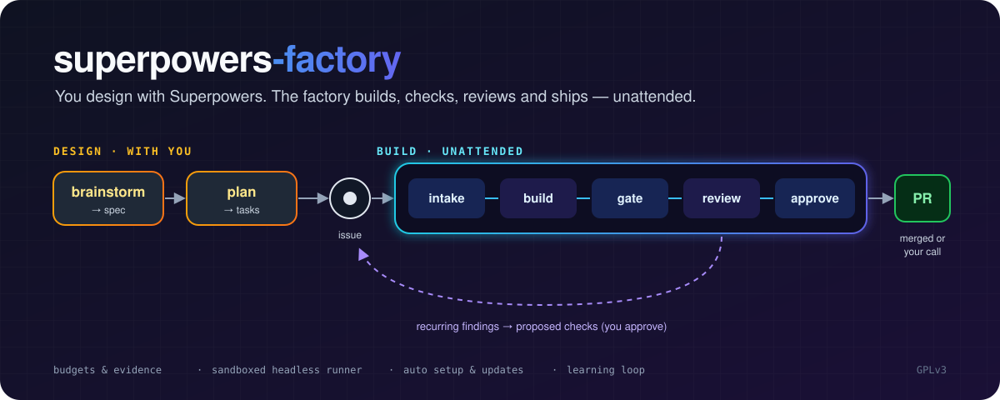

# superpowers-factory



**You design the feature with Claude. The factory builds it.**

superpowers-factory is a Claude Code plugin that joins two halves of the work:

- **Design, with you.** You brainstorm and write a plan interactively using the
  [Superpowers](#requirements) skills.
- **Build, unattended.** The plan becomes one GitHub issue. A software factory of
  Claude agents picks it up, writes the code on its own branch, runs your
  project's checks, reviews the change, and either merges the pull request or
  hands it to you with the evidence.

You stay in charge of the decisions: what gets built, what's allowed to merge,
and how much it may spend.

---

## Contents

- [How it works](#how-it-works)
- [Requirements](#requirements)
- [Install](#install)
- [Quick start](#quick-start)
- [Everyday use](#everyday-use)
- [Configuration](#configuration)
- [Hands-off running (macOS)](#hands-off-running-macos)
- [The learning loop](#the-learning-loop)
- [Safety: what stays with you](#safety-what-stays-with-you)
- [Troubleshooting](#troubleshooting)
- [Contributing and license](#contributing-and-license)

---

## How it works

```
 you + Claude                         the factory (unattended)
┌─────────────┐   ┌──────┐   ┌───────┐   ┌────────┐   ┌───────┐   ┌──────┐   ┌────────┐   ┌─────────┐   ┌────┐
│ brainstorm  │ → │ plan │ → │ issue │ → │ intake │ → │ build │ → │ gate │ → │ review │ → │ approve │ → │ PR │
└─────────────┘   └──────┘   └───────┘   └────────┘   └───────┘   └──────┘   └────────┘   └─────────┘   └────┘
                                 ▲                                                │
                                 └─────── recurring findings → proposed checks ───┘
```

1. **Design.** In a normal Claude Code session you use Superpowers'
   brainstorming and writing-plans skills. The result is a spec and a step-by-step
   plan, committed to your repo.
2. **Hand off.** When writing-plans asks how to run the plan, pick
   **"3. Factory"**. `/factory-handoff` files one GitHub issue labeled
   `factory` + `factory:planned` that points at the committed spec and plan.
3. **Build.** `/factory run` (or the scheduled runner) takes each labeled issue
   through these stages, one job per issue:

   | Stage | Who | What happens |
   |---|---|---|
   | intake | `intake` agent | Decides whether the issue is worth building and how risky it is. Planned issues skip this; their plan is used as written. |
   | spec | `spec-writer` agent | Turns the issue into testable acceptance criteria (skipped for planned issues). |
   | build | `builder` agent | Implements the work in its own git worktree, test-first, and opens a draft PR. |
   | gate | `factory/bin/gate` | Runs your `factory/checks.sh` (tests, lint, build). Code, not a model, decides pass or fail. |
   | review | reviewer agents | A code reviewer always; UX, UI and security reviewers when the change touches those areas. |
   | approve | `approver` agent | Merges what it would merge itself, or escalates the PR to you. |

   A failed gate or a review asking for changes sends the job back to build,
   up to `max_rounds` times.
4. **Finish.** Every PR the factory sends to the approver or to you carries an
   **evidence block**: files changed, check output, acceptance criteria, each
   reviewer's verdict, and the cost and time spent. Jobs that need you are
   labeled `factory:needs-human`.

Plain issues work too: label any issue `factory` and the factory takes it from
intake. The plan-based route is better for anything larger than a small fix.

---

## Requirements

- **Claude Code** 2.1.257 or later.
- **The Superpowers plugin**, installed in Claude Code. The factory's builder
  uses its test-driven-development, debugging and verification skills.
- **GitHub**: a project with an `origin` on GitHub, and the
  [`gh` CLI](https://cli.github.com) logged in with an account that can push
  and manage labels.
- **Python 3.10+** (the factory's scripts use only the standard library).
- macOS, only if you want the [scheduled runner](#hands-off-running-macos).

---

## Install

In Claude Code:

```text
/plugin marketplace add nandan-exale/superpowers-factory
/plugin install superpowers-factory@superpowers-factory
```

Restart Claude Code (or open a new session) so the plugin's skills and hooks
load.

To update later:

```text
/plugin marketplace update superpowers-factory
/plugin update superpowers-factory@superpowers-factory
```

If you installed it for a single project (`--scope project`), run the update
from that project with the same scope.

Installed it before the marketplace was renamed (as
`superpowers-factory@superpowers-factory-dev`)? Remove the old marketplace and
install again:

```text
/plugin marketplace remove superpowers-factory-dev
/plugin marketplace add nandan-exale/superpowers-factory
/plugin install superpowers-factory@superpowers-factory
```

---

## Quick start

1. **Open a session in your project.** The plugin notices the factory isn't
   installed and offers `/factory-install`. Say yes.
2. **Let it set up.** It copies the factory into the project and adapts it:
   - writes your real test, lint and build commands into `factory/checks.sh`;
   - tailors the reviewer checklists to your stack;
   - creates the GitHub labels;
   - adds a CI workflow and a check that runs before a session ends;
   - runs `factory/bin/doctor` to confirm everything is in place.

   Review the changes, then commit and push them yourself.
3. **Start a fresh session.** The factory's agents load at session start.
4. **Design something.** Ask Claude to build a feature. Superpowers takes you
   through brainstorming and a written plan.
5. **Hand it off.** When asked how to execute the plan, choose
   **"3. Factory"**. Confirm the risk level, and the issue is filed.
6. **Run the factory.** In a fresh session: `/factory run`. Watch the PR
   appear on GitHub. Start with `concurrency: 1` and read every PR until you
   trust it.

---

## Everyday use

### Commands

| Command | Where | What it does |
|---|---|---|
| `/factory-install` | Claude Code, in a project | Sets the factory up in the current project. |
| `/factory-update` | Claude Code, in a project | Updates an installed factory to the plugin's version. Keeps your changes, shows every diff, never commits. |
| `/factory-uninstall` | Claude Code, in a project | Removes the factory from this project (keeps job history and labels). |
| `/factory-handoff` | Claude Code, after a plan | Files the committed spec and plan as one `factory:planned` issue. |
| `/factory run` | Claude Code | Builds every open `factory` issue, `concurrency` at a time. |
| `/factory run <n>` | Claude Code | Builds only issue `#n`. |
| `/factory <anything>` | Claude Code | Ask about jobs, give feedback on an escalated PR, or describe a new feature. |
| `factory/bin/doctor` | terminal | Checks the install. `--fast` skips running your checks. |
| `factory/bin/job summary` | terminal | Table of jobs: stage, PR, cost against budget, time. |
| `factory/bin/job queue` | terminal | What `/factory run` would do with each issue right now. |

A live dashboard: `cd factory && python3 -m http.server`, then open
<http://localhost:8000/dashboard.html>.

**Large plans.** When a plan has more tasks than
`handoff.max_tasks_per_part` (8 by default), `/factory-handoff` proposes
splitting it into parts and files one issue per part, in order. Each part is
its own PR, carrying out only its task range. A part waits
(`wait … depends #N` in `job queue`) until the part before it has merged; if
that part is rejected or its issue is closed unmerged, the next part stops at
`needs-human` so you can re-plan.

### Approving and steering

- **To approve** an escalated PR, merge it on GitHub.
- **To change it**, comment on the PR. Comments from you (and logins in
  `pr_feedback.allowed`) reach the builder automatically on the next run. You
  can also use `/factory <what to change>`.
- **To stop** a job, close the issue or reject it with `/factory`.

### Keeping the factory up to date

When the plugin is newer than a project's factory, Claude offers
`/factory-update` at the start of a session. It copies files you haven't
changed, adds new config keys while keeping your values, never touches
`factory/checks.sh`, and asks you about any file both you and the plugin
changed.

### Removing the factory

Run `/factory-uninstall` in the project. It stops the runner, removes the
factory's files, Stop hook, CI workflow and AGENTS.md section, and shows you
the diff to commit. It keeps `factory/jobs/` (your job history), your own
`factory/checks.sh` and the GitHub labels, and prints the commands to delete
them if you want to. It refuses while a job still has a worktree.

---

## Configuration

Everything lives in **`factory/config.json`** in your project. The factory can't
change this file itself; edit it by hand and commit.

### The basics

| Key | Default | Meaning |
|---|---|---|
| `concurrency` | `3` | How many jobs run at once. Start with `1`. |
| `max_rounds` | `3` | Build → review rounds before a job is escalated to you. |
| `base_branch` | `"main"` | Branch jobs start from and merge into. |
| `merge_method` | `"merge"` | `merge`, `squash` or `rebase` (must be allowed by the repo). |
| `protected_paths` | `factory/checks.sh`, `factory/config.json` | Files no job may change. Add paths only when no job should ever touch them. |
| `ports` | `{"base": 5100, "step": 10}` | Ports given to each job's dev server. |
| `labels` | `factory`, `factory:planned`, … | GitHub label names, if you need different ones. |

### Models and effort

No agent file names a model; every agent's model and effort come from config,
chosen per job by its risk:

```json
"agents":  { "intake":  { "model": "fable", "effort": "high" },
             "learner": { "model": "opus",  "effort": "high" } },
"routing": {
  "low":    { "spec-writer": {...}, "builder": {...}, "approver": {...}, "code": {...} },
  "medium": { ... },
  "high":   { ... }
},
"surface_reviewers": {
  "ui":       { "ux": {...}, "ui": {...} },
  "security": { "security": {...} }
}
```

- `model` is one of `model_aliases` (`fable`, `opus`, `sonnet`, `haiku`).
- `effort` is one of `effort_levels` (`low` … `max`).
- `routing.<risk>.code` is the code reviewer; `surface_reviewers` adds reviewers
  when intake says a change touches the UI or security.
- See what an agent will run on: `factory/bin/job agent <job> <role>`.

### Budgets

```json
"budgets": { "job_usd": 25, "job_hours": 6, "daily_usd": 100 }
```

| Key | Meaning |
|---|---|
| `job_usd` | Most a single job may spend (API-equivalent). Over it, the job stops and comes to you. |
| `job_hours` | Longest a job may take from the start of its build. |
| `daily_usd` | Most the factory may spend in any 24 hours. Past it, nothing new starts until spend drops. |

Set any of them to `null` to turn that limit off. Your feedback on an escalated
job gives it a fresh allowance. Costs are API-equivalent estimates from the
agents' token usage (`prices_usd_per_mtok`).

### PR comments

```json
"pr_feedback": { "allowed": ["teammate-login"] }
```

Who, besides you (the `gh` account running the factory), may steer a job by
commenting on its PR. Bots and everyone else are ignored.

### Learning loop

```json
"learning": { "threshold": 3, "window_days": 30, "tags": ["missing-test", "error-handling", "..."] }
```

How many different jobs must raise the same kind of finding, within how many
days, before the factory proposes a fix. `tags` is the list reviewers choose
from.

### Scheduled runner

```json
"runner": { "interval_minutes": 15, "max_minutes": 120, "keychain_service": "factory-claude-token" }
```

How often the runner checks for work, how long one run may take, and the
Keychain item holding its token. See below.

### Other files you own

| File | What it is |
|---|---|
| `factory/checks.sh` | Your project's checks. Must exit non-zero on any failure. |
| `factory/runner-settings.json` | Sandbox and permission rules for the scheduled runner. Add your package registries to `sandbox.network.allowedDomains`. |
| `.claude/agents/reviewer-*.md` | Reviewer checklists, tailored at install. |
| `AGENTS.md` | Setup and validation commands every agent reads. |

---

## Hands-off running (macOS)

Want the factory to work while you're away? The runner starts `/factory run`
on a schedule, but only when there's work.

1. **Make a separate clone** of your project for the runner. It never touches a
   checkout with uncommitted changes.
2. **Give it a login token** (you do this; the plugin never sees it):
   ```bash
   claude setup-token
   security add-generic-password -s factory-claude-token -a "$USER" -w
   ```
   Paste the token when `security` asks.
3. **Turn on branch protection** for your base branch on GitHub (no force
   pushes, no deletion).
4. **Install the schedule**, in the runner's clone:
   ```bash
   factory/bin/runner install
   ```

Check on it with `factory/bin/runner status`. Remove it with
`factory/bin/runner uninstall`.

Each run is headless, uses `--permission-mode dontAsk`, and runs commands in
Claude Code's sandbox: writes stay in the project, network access is limited
to GitHub and the hosts you list, and anything not allowed is refused rather
than asked about.

---

## The learning loop

Reviewers tag every finding (`[missing-test]`, `[error-handling]`, …). When the
same tag keeps coming up across jobs, the factory's `learner` drafts the
smallest automatic fix — a lint rule, a test, a check script, or an
`AGENTS.md` rule — and files it as a **`factory:learning`** issue with the
evidence.

Nothing changes until you decide: read the proposal, and **add the `factory`
label** if you want the factory to build it. Proposals that need a protected
file say so, and are yours to make.

---

## Safety: what stays with you

- **Merging.** Only the approver or you merge, and only after the checks pass
  and the reviewers agree. Merging an escalated PR on GitHub is your approval.
- **Spending.** Per-job and daily budgets are enforced in code, not left to the
  model.
- **Your checks.** Jobs can't change `factory/checks.sh` or
  `factory/config.json`, so a job can't weaken the checks it's judged by.
- **New rules.** Learning proposals only become work when you add the label.
- **Credentials.** The runner's token stays in your Keychain and is kept away
  from the commands agents run.

Good to know:

- Your project's tests run with full network and disk access when the gate
  runs them (they never see the token).
- The factory can comment, open PRs and push branches on GitHub as your `gh`
  account.
- Changes to the factory's own files take effect once merged into the base
  branch, so review them like any other change.

---

## Troubleshooting

| Problem | Try |
|---|---|
| Something seems off | `factory/bin/doctor` lists each check as PASS, WARN or FAIL with the fix. |
| `/factory run` can't find the agents | Start a fresh session; agents load only at session start. |
| Claude doesn't offer `/factory-install` | The project needs a GitHub `origin`. If you declined before, `bin/factory-state reset` (in the plugin) brings the offer back. |
| A job is stuck or escalated | `factory/bin/job summary`, then read the PR's evidence block and the latest `factory/jobs/<job>/decision.md`. |
| The runner isn't running | `factory/bin/runner status` shows the last runs and why it skipped. |
| Nothing starts, `wait … daily budget` | The daily spend limit is reached; it clears as the last 24 hours roll over, or raise `budgets.daily_usd`. |

---

## Contributing and license

Working on the plugin itself? Read `AGENTS.md` and run `scripts/check` before
calling a change done; CI runs the same script.

- `skills/`: the plugin's skills (`factory-install`, `factory-update`,
  `factory-handoff`, and the bundled `agents-best-practices`, MIT-licensed,
  vendored with two modifications listed in its `SOURCE`).
- `bin/`, `hooks/`: the plugin's session hook and update scripts.
- `vendor/factory/`: the factory copied into projects. The first commit in
  `git log -- vendor/factory` is the unmodified import; every later commit is a
  modification (see `vendor/factory/NOTICE`).

### Proving changes with real agents

Two maintainer tools spend real money, so they never run in CI. Run them by hand
before a release that changes agent prompts or the job state machine.

**Prompt evals** run each agent prompt against small fixtures in `tests/evals/`
and compare pass rates with `tests/evals/baseline.json`:

```bash
scripts/eval --samples 3 --max-usd 5
```

Add `--agent reviewer-code` to run one agent. A case fails when its pass rate
falls more than one sample below its baseline. After a prompt change you mean,
run with `--update-baseline` and review the diff before committing it.

**End-to-end scenarios** run the whole factory on a disposable GitHub repo.
Make the sandbox once: a new private repo whose name contains `e2e` or
`sandbox` (for example `factory-e2e`), holding a tiny Python CLI (`app.py`
with an argparse entry point, a `VERSION` file and one unittest), with the
factory installed (`/factory-install`) and committed. Then, from this repo:

```bash
scripts/e2e --sandbox ~/src/factory-e2e --max-usd 10
```

`--only <scenario>` runs one, and `--keep` leaves its issue, PR and branch open
for a look. Results are in `e2e-results/<timestamp>/`. The tool refuses
any repo that isn't on github.com, is this plugin's repo, or lacks `e2e` or
`sandbox` in its name. It also refuses a clone whose pushes or `gh` would reach
another repo, and pins every `gh` call it and the factory make to the sandbox
(`GH_REPO`). The `runner-tick` scenario needs the runner's Keychain token and is
skipped without it.

Licensed under **GPLv3**, because `vendor/factory/` is a modified copy of
GPLv3-licensed code.
